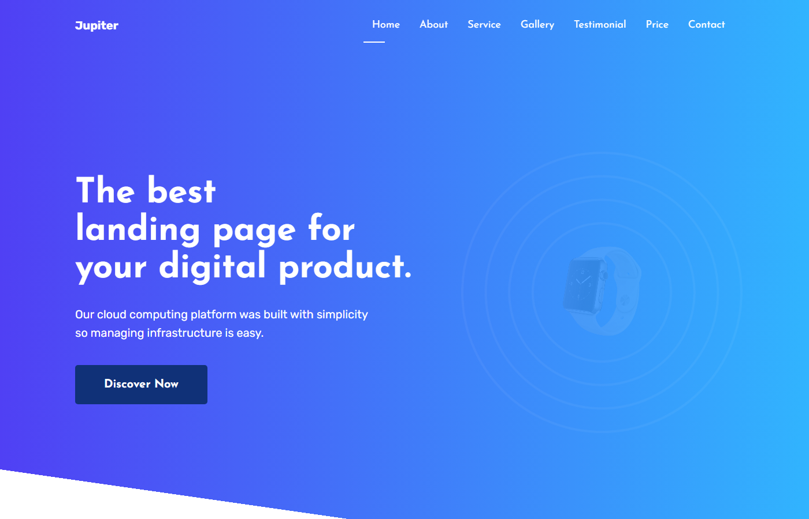
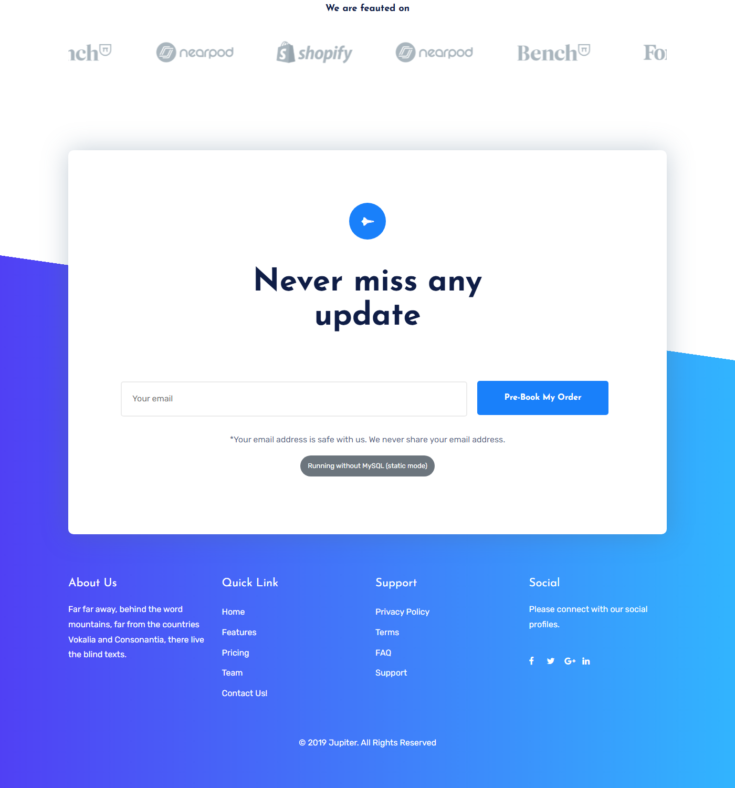
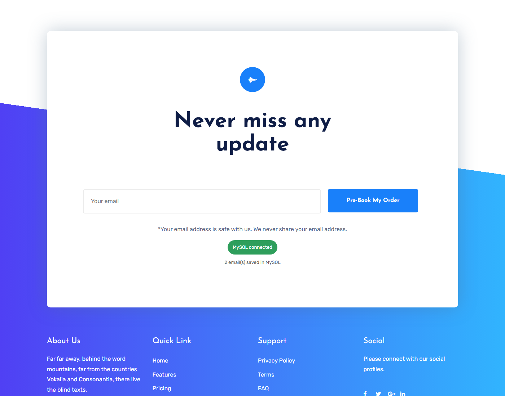

# kubernetesproject2 – Jupiter site + API + MySQL (Docker → CI/CD → Docker Hub → kind)

A practice project for Docker, CI/CD and Kubernetes.

It started as the public image `get2kunle/staticsite:latest`, an nginx container serving the
"Jupiter" one-page HTML template. That image was taken apart and rebuilt as a small 3-tier app:

```
 browser ──► web (nginx, port 80) ──/api/*──► api (Node.js, port 3000) ──► mysql (port 3306)
             serves the website              saves newsletter emails       OPTIONAL
```

The site works **with or without MySQL**:

| Mode | What you see | Subscribe form |
|------|--------------|----------------|
| **Without MySQL** | Full website, grey badge **"Running without MySQL (static mode)"** | Replies "This site is running without MySQL, so emails are not saved." |
| **With MySQL** | Full website, green badge **"MySQL connected"** + "N email(s) saved in MySQL" | Saves the email in the `subscribers` table |
| MySQL set but down | Full website, red badge **"MySQL configured but unreachable"** | Asks you to try again later. The API reconnects by itself when MySQL comes back. |



**Without MySQL:**



**With MySQL** (after saving two emails):



> These screenshots were taken on the laptop without Docker, using the "Run WITHOUT Docker" steps in section 4.3
> with a local MySQL 8.4 on port 3307.

---

## 1. What was done (change log)

1. **Got the site out of the image.** Downloaded `get2kunle/staticsite:latest` from Docker Hub.
   It is `nginx:alpine` (nginx 1.29.4) with the site copied to `/usr/share/nginx/html`.
   The site files are now in `web/html/`.
2. **Cleaned up the web root.** The old image also published `docker-compose.yml`, `.dockerignore`
   and the AWS diagram to the public site. Now only `index.html`, `style.css` and `assets/` go into the image.
   The diagram moved to `docs/`.
3. **Replaced MailChimp with MySQL.** The "Never miss any update / Pre-Book My Order" form posted to a demo
   MailChimp list. That code was removed from `assets/js/main.js`. The new `assets/js/subscribe.js` posts to
   `/api/subscribers` and shows the live database status badge. Two small blocks were added to `index.html`,
   marked with `<!-- Added: ... -->` comments.
4. **Added an API** (`api/`, Node.js 22 + Express + mysql2). MySQL is optional (controlled by `DB_HOST`).
   It retries the connection and creates the table automatically. It has health endpoints for Docker and
   Kubernetes probes, and a unit test.
5. **Added nginx config** (`web/nginx.conf`) that serves the site and proxies `/api/` to the service named `api`.
   The name is the same in Docker Compose and Kubernetes, so the same image works in both.
6. **Added Docker Compose files:** `docker-compose.yml` (without MySQL) and `docker-compose.mysql.yml`
   (adds MySQL 8.4 with a named volume and healthcheck).
7. **Added CI/CD** (`.github/workflows/ci-cd.yml`). It tests, builds, runs the stack both with and without
   MySQL, then pushes both images to Docker Hub.
8. **Added Kubernetes manifests for kind** (`k8s/`): namespace, Deployments, Services, ConfigMap, Secret,
   PVC, probes and resource limits, plus a kind config with a port mapping.

## 2. Project layout

```
kubernetesproject2/
├── web/                     # image: <user>/staticsite
│   ├── Dockerfile           # nginx:1.29-alpine + site
│   ├── nginx.conf           # serves site, proxies /api -> api:3000
│   └── html/                # the Jupiter website (index.html, style.css, assets/)
├── api/                     # image: <user>/staticsite-api
│   ├── Dockerfile           # node:22-alpine
│   ├── server.js            # Express API (MySQL optional)
│   ├── server.test.js       # unit test used by CI
│   └── package.json / package-lock.json
├── mysql/init.sql           # creates the subscribers table (first start only)
├── docker-compose.yml       # MODE 1: web + api (no MySQL)
├── docker-compose.mysql.yml # MODE 2: adds mysql (use with the file above)
├── .env.example             # copy to .env for your passwords / Docker Hub user
├── .github/workflows/ci-cd.yml
├── k8s/
│   ├── kind-config.yaml     # kind cluster, maps NodePort 30080 -> localhost:8081
│   ├── base/                # namespace, web, api, api-config (no MySQL)
│   └── mysql/               # secret, PVC, mysql deployment+service, api-config with DB_HOST=mysql
└── docs/                    # screenshots + original AWS diagram
```

### API endpoints

| Method | Path | Purpose |
|--------|------|---------|
| GET | `/healthz` | Liveness/readiness probe (200 while the process is up) |
| GET | `/api/health` | `{"status":"ok","database":"connected" \| "not configured" \| "unreachable"}` |
| GET | `/api/subscribers/count` | Number of saved emails |
| GET | `/api/subscribers` | Last 50 emails |
| POST | `/api/subscribers` | Body `{"email":"you@example.com"}` saves an email (503 without MySQL) |

### API environment variables

| Variable | Default | Meaning |
|----------|---------|---------|
| `PORT` | `3000` | Port the API listens on |
| `DB_HOST` | *(empty)* | **Empty = run without MySQL.** Set it to the MySQL host to enable the database |
| `DB_PORT` / `DB_NAME` / `DB_USER` / `DB_PASSWORD` | `3306` / `jupiter` / `jupiter` / *(empty)* | MySQL connection |
| `STATIC_DIR` | *(empty)* | Also serve the website from this folder. Only used to run without Docker (section 3) |

---

## 3. Working environment setup (Windows laptop)

Install these once:

| Tool | Why | Install |
|------|-----|---------|
| **Docker Desktop** | Build and run containers, and kind runs inside it | https://www.docker.com/products/docker-desktop/. Pick the **WSL 2** backend. It installs WSL and asks for a reboot. |
| **Git** | Push to GitHub to trigger CI/CD | Already installed |
| **kubectl** | Talk to Kubernetes | `winget install -e --id Kubernetes.kubectl` |
| **kind** | Kubernetes cluster inside Docker | `winget install -e --id Kubernetes.kind` |
| Node.js 22 *(optional)* | Run the API/tests without Docker | `winget install -e --id OpenJS.NodeJS.LTS` |
| MySQL 8.4 *(optional)* | Only for running with MySQL **without** Docker | `winget install -e --id Oracle.MySQL` |

Open a **new** terminal afterwards and check:

```powershell
docker version
docker compose version
kubectl version --client
kind version
```

All commands below are run from the `kubernetesproject2` folder.

---

## 4. Run on your laptop with Docker Compose (do this before kind)

### 4.1 Mode 1: WITHOUT MySQL

```powershell
docker compose up -d --build
docker compose ps
```

Open **http://localhost:8080**. Scroll to "Never miss any update". The badge is grey:
*Running without MySQL (static mode)*.

```powershell
curl.exe http://localhost:8080/api/health
# {"status":"ok","database":"not configured"}
```

Stop it:

```powershell
docker compose down
```

### 4.2 Mode 2: WITH MySQL

```powershell
copy .env.example .env      # optional: change the passwords in .env
docker compose -f docker-compose.yml -f docker-compose.mysql.yml up -d --build
docker compose -f docker-compose.yml -f docker-compose.mysql.yml ps   # wait until mysql is "healthy"
```

Open **http://localhost:8080**. The badge turns green: *MySQL connected*.
Type an email and click **Pre-Book My Order**. You get "Thanks! … was saved in MySQL." and the counter goes up.

Check the data:

```powershell
curl.exe http://localhost:8080/api/subscribers
docker compose -f docker-compose.yml -f docker-compose.mysql.yml exec mysql `
  mysql -ujupiter -pjupiterpass jupiter -e "SELECT * FROM subscribers;"
```

Watch the site survive a database outage:

```powershell
docker compose -f docker-compose.yml -f docker-compose.mysql.yml stop mysql    # badge turns red, site still works
docker compose -f docker-compose.yml -f docker-compose.mysql.yml start mysql   # badge back to green after a few seconds
```

Stop everything:

```powershell
docker compose -f docker-compose.yml -f docker-compose.mysql.yml down       # keeps the data volume
docker compose -f docker-compose.yml -f docker-compose.mysql.yml down -v    # also deletes the MySQL data
```

### 4.3 (Optional) Run WITHOUT Docker

Requires Node.js 22.

```powershell
cd api
npm install
npm test                                    # unit test (no MySQL needed)

# without MySQL
$env:PORT="8080"; $env:STATIC_DIR="..\web\html"; npm start
# open http://localhost:8080

# with a local MySQL (create the database and user first, see mysql/init.sql)
#   CREATE USER 'jupiter'@'localhost' IDENTIFIED BY 'jupiterpass';
#   CREATE DATABASE jupiter; GRANT ALL ON jupiter.* TO 'jupiter'@'localhost';
$env:DB_HOST="127.0.0.1"; $env:DB_PORT="3306"; $env:DB_USER="jupiter"; $env:DB_PASSWORD="jupiterpass"; npm start
# open http://localhost:8080 -> green "MySQL connected" badge
```

---

## 5. CI/CD: GitHub Actions → Docker Hub

The workflow `.github/workflows/ci-cd.yml` runs on GitHub:

| Job | When | What it does |
|-----|------|--------------|
| `test` | Every push and PR | `npm ci` + `npm test` for the API |
| `smoke-test` | After `test` | Builds both images, runs the stack **without MySQL** (expects 503 on subscribe), then **with MySQL** (saves and reads back an email). If anything fails, it prints the logs. |
| `push` | Push to `main` or a manual run | Builds and pushes `<user>/staticsite` and `<user>/staticsite-api`, tagged `latest` and `sha-<commit>` |

### One-time setup

1. Create a Docker Hub access token: Docker Hub → *Account settings* → *Personal access tokens* →
   *Generate* (Read & Write).
2. Create an empty GitHub repository, for example `kubernetesproject2`.
3. In that repo go to *Settings → Secrets and variables → Actions → New repository secret* and add:
   - `DOCKERHUB_USERNAME` = `get2kunle`
   - `DOCKERHUB_TOKEN` = the token from step 1
4. Push this folder:

```powershell
git init -b main
git add .
git commit -m "Jupiter site + API + MySQL with CI/CD and k8s manifests"
git remote add origin https://github.com/<your-github-user>/kubernetesproject2.git
git push -u origin main
```

5. Watch the run in the repo's **Actions** tab. When it is green the images are on Docker Hub:
   `get2kunle/staticsite:latest` (this replaces the old image) and `get2kunle/staticsite-api:latest`.

> Using a different Docker Hub account? Change `get2kunle` in `.env`, `k8s/base/web.yaml` and `k8s/base/api.yaml`.

---

## 6. Kubernetes on kind

```powershell
kind create cluster --name jupiter --config k8s/kind-config.yaml
kubectl cluster-info --context kind-jupiter
```

**Images:** the manifests use `get2kunle/staticsite:latest` and `get2kunle/staticsite-api:latest`.
- If CI has already pushed them, kind pulls them from Docker Hub automatically.
- To test images you built locally *before* pushing, load them into kind:
  ```powershell
  docker compose build
  kind load docker-image get2kunle/staticsite:latest get2kunle/staticsite-api:latest --name jupiter
  ```

### 6.1 Without MySQL

```powershell
kubectl apply -f k8s/base/
kubectl -n jupiter get pods -w          # wait for web and api to be Running (Ctrl+C to stop watching)
```

Open **http://localhost:8081**. The badge is grey (*static mode*).

### 6.2 With MySQL

```powershell
kubectl apply -f k8s/mysql/
kubectl -n jupiter rollout status deployment/mysql
kubectl -n jupiter rollout restart deployment/api    # reload api-config (DB_HOST=mysql) + secret
kubectl -n jupiter rollout status deployment/api
```

Refresh **http://localhost:8081**. The badge is green and emails are saved in MySQL on a PersistentVolume.

> Order matters: `k8s/mysql/api-config-mysql.yaml` overwrites the `api-config` ConfigMap from `k8s/base/`.
> If you re-apply `k8s/base/` later, apply `k8s/mysql/` again and restart the api.

### 6.3 Back to without MySQL

```powershell
kubectl apply -f k8s/base/api-config.yaml
kubectl -n jupiter rollout restart deployment/api
kubectl -n jupiter delete -f k8s/mysql/mysql.yaml     # also deletes the PVC (the data)
```

### Useful practice commands

```powershell
kubectl -n jupiter get all
kubectl -n jupiter logs deploy/api -f
kubectl -n jupiter describe pod -l app=web
kubectl -n jupiter scale deployment/web --replicas=4
kubectl -n jupiter exec -it deploy/mysql -- mysql -ujupiter -pjupiterpass jupiter -e "SELECT * FROM subscribers;"
kubectl -n jupiter port-forward svc/web 9090:80        # another way in: http://localhost:9090
kubectl -n jupiter set image deployment/web web=get2kunle/staticsite:sha-<commit>   # roll out a CI build
kubectl -n jupiter rollout undo deployment/web
```

Clean up:

```powershell
kind delete cluster --name jupiter
```

---

## 7. Troubleshooting

| Problem | Fix |
|---------|-----|
| `docker` not recognized | Docker Desktop isn't installed or running, or you need a new terminal |
| Port 8080 already in use | Change `"8080:80"` in `docker-compose.yml` (for example to `"8090:80"`) |
| Port 3306 in use (local MySQL) | Remove or change the `ports:` block of `mysql` in `docker-compose.mysql.yml`. The app doesn't need it. |
| Badge says "unreachable" right after start | MySQL takes about 20–30 seconds on first start. The API retries every 3 seconds. |
| Changed the MySQL password but the login fails | The password is set only when the volume is first created: `down -v` and start again |
| kind pods `ImagePullBackOff` | The image isn't on Docker Hub yet. Push via CI, or use `kind load docker-image` (section 6) |
| CI `push` job fails at login | Check the `DOCKERHUB_USERNAME` / `DOCKERHUB_TOKEN` secrets |

> The passwords in `.env.example` and `k8s/mysql/mysql-secret.yaml` are for practice only.
